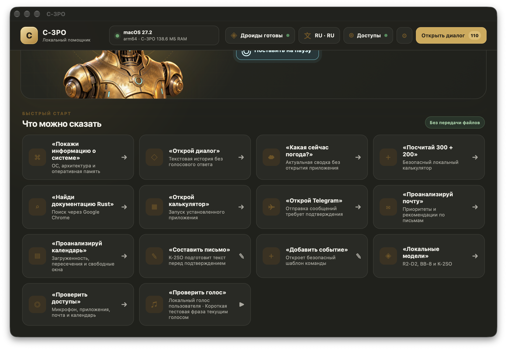
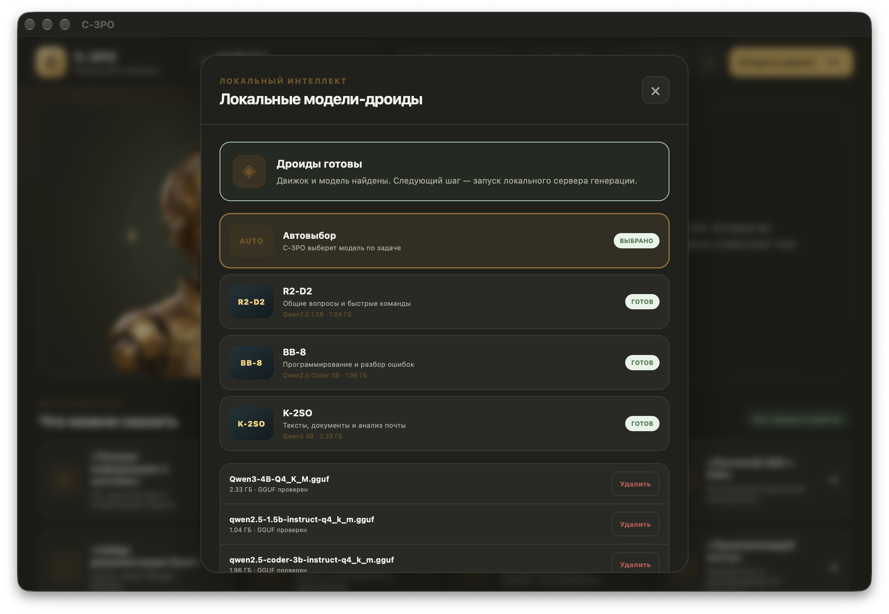

# C-3PO Local Assistant

<p align="center">
  
</p>

<p align="center">
  Локальный голосовой помощник для macOS и Windows.<br>
  Общение, работа с компьютером, специализированные модели и контроль действий — в одном приложении.
</p>

<p align="center">
  <a href="https://github.com/livej0urnal/local-ai-assistant/releases/latest"></a>
  <a href="https://github.com/livej0urnal/local-ai-assistant/actions/workflows/release.yml"></a>
  
  
</p>

## Обзор

C-3PO — настольный помощник с голосовым и текстовым интерфейсом, локальными GGUF-моделями и
проверяемым Rust-ядром. Он умеет открывать установленные приложения, анализировать файлы, проекты,
почту, календарь и экран, работать с кодом, планировать фоновые задачи и показывать ход выполнения.

Модель не получает прямого доступа к shell. Сначала запрос классифицируется, затем Rust проверяет
аргументы и разрешения. Безопасные операции выполняются сразу, а отправка, удаление и другие
изменяющие действия требуют явного подтверждения пользователя.

```text
Голос или чат → маршрутизация → локальная модель/инструмент → проверка Rust → результат → журнал/отмена
```

## Интерфейс

### Голосовой режим и быстрый старт



Главный экран показывает состояние ОС, расход памяти C-3PO, готовность локальных моделей и
разрешений. Карточки быстрого старта охватывают приложения, интернет-поиск, файлы, код, почту,
календарь, модели, голос и отложенные задачи.

### Локальные модели-дроиды



Автоматический режим выбирает модель по типу запроса. Router llama.cpp держит в памяти только одну
тяжёлую модель одновременно — это снижает расход ОЗУ на компьютерах с ограниченными ресурсами.

## Возможности

| Направление | Что умеет C-3PO |
|---|---|
| Голос | фоновое пробуждение по имени, автоматическое прослушивание, прерывание озвучки новой речью, беззвучный режим |
| Диалоги | отдельные беседы и профили, история сообщений, удаление и очистка, автоматическая прокрутка к последнему сообщению |
| Приложения | поиск и запуск установленных приложений по реальному системному каталогу без произвольных shell-команд |
| Файлы | поиск, чтение и анализ текста и кода до 2 МБ, обратимое перемещение и переименование без перезаписи |
| Код | индекс проекта, выбор релевантных файлов, Git-контекст, unified diff, тесты и автоматический откат неудачного патча |
| Экран | локальный снимок после системного разрешения и анализ визуальной моделью BD-1 |
| Интернет | безопасный браузерный поиск и текущая погода без запуска системного приложения «Погода» |
| Почта | локальный обзор Apple Mail, приоритеты, рекомендации и подтверждаемое создание черновика |
| Календарь | анализ загрузки, пересечений и свободных окон; подтверждаемое создание события |
| Telegram | выбор контакта, предпросмотр полного текста и отдельное подтверждение отправки на macOS |
| Планировщик | предложения задач из диалога, локальная очередь, прогресс, результат и системные уведомления |
| Система | реальная ОС и архитектура, память компьютера, текущий/базовый/пиковый RSS приложения, журнал ошибок |
| Интерфейс | светлая, тёмная и системная темы; 10 языков интерфейса и команд; значок в строке меню |

## Локальные модели

| Имя в интерфейсе | Модель | Назначение |
|---|---|---|
| R2-D2 | Qwen2.5 1.5B Instruct | общение, вопросы и быстрые команды |
| BB-8 | Qwen2.5-Coder 3B | программирование, анализ проектов и подготовка патчей |
| K-2SO | Qwen3 4B | документы, длинные тексты, почта и календарь |
| BD-1 | Qwen2.5-VL 3B + mmproj | локальный анализ текущего экрана |

Установщик содержит совместимый `llama-server`. Модели устанавливаются из панели приложения после
согласия пользователя, проверяются как GGUF и сохраняются в локальной папке данных. Полный
рекомендуемый комплект занимает около 8,5 ГБ; пользователь может оставить только нужные модели.

## Отложенные задачи

C-3PO распознаёт расписание непосредственно в сообщении и предлагает проверить карточку до
сохранения:

- «Напомни через 20 минут выпить воды»;
- «Завтра в 9:30 проанализируй почту и выдели важное»;
- «Сегодня в 18:00 проверь календарь»;
- «Покажи отложенные задачи».

Безопасные задачи выполняются последовательно в фоне. Уведомления сообщают о начале, завершении и
ошибках. Задачи с отправкой, удалением, созданием или перемещением данных переходят в состояние
«нужно подтверждение» и не изменяют систему автоматически.

## Безопасность и приватность

- локальные модели работают через `127.0.0.1` и не получают прямого доступа к ОС;
- файловые пути нормализуются и проверяются Rust-ядром;
- кодовый патч ограничен корнем проекта, размером и количеством файлов;
- целевые файлы с пользовательскими незакоммиченными изменениями не перезаписываются;
- после изменения кода запускаются известные тесты, неуспешный патч откатывается;
- аудио и текст голосовых команд не записываются в журнал;
- действия журналируются без содержимого сообщений, писем и поисковых запросов;
- микрофон, уведомления, автоматизация и запись экрана управляются штатными разрешениями ОС;
- снимок экрана уменьшается, анализируется локально и не сохраняется в журнале.

Подробная модель угроз и правила раскрытия проблем описаны в [SECURITY.md](SECURITY.md).

## Скачать и установить

Установщики публикуются на странице [последнего релиза](https://github.com/livej0urnal/local-ai-assistant/releases/latest).

| Платформа | Файл релиза |
|---|---|
| macOS Apple Silicon (M1–M5) | `.dmg` с `aarch64` в имени |
| macOS Intel | `.dmg` с `x64` или `x86_64` в имени |
| Windows 10/11 x64 | установщик `.exe` (NSIS) |

В релиз также входит `SHA256SUMS.txt` с контрольными суммами. Rust, Node.js и Python обычному
пользователю не требуются. Сборки без сертификатов Apple и Microsoft могут вызвать стандартное
предупреждение операционной системы; сверяйте контрольную сумму и источник файла.

### Первый запуск

1. Запустите C-3PO и пройдите единый мастер доступов.
2. Разрешите микрофон и уведомления; доступ к Mail, Calendar, управлению и экрану выдаётся только
   для соответствующих функций.
3. Откройте панель моделей и установите рекомендуемый комплект либо выбранные модели.
4. Выберите тему, язык интерфейса, язык команд, микрофон и голосовой режим.
5. Скажите «C-3PO» для открытия или «C-3PO, покажи информацию о системе» для фоновой команды.

Крестик скрывает окно, сохраняя помощника в строке меню. Пункт «Завершить C-3PO» полностью
останавливает приложение и локальные процессы моделей.

## Примеры команд

```text
Покажи информацию о системе
Открой Google Chrome и найди документацию Rust
Найди файл README.md
Проанализируй проект local-ai-assistant
Исправь проект local-ai-assistant: добавь проверку пустого имени файла
Что сейчас на моём экране?
Проанализируй почту и расставь приоритеты
Проанализируй календарь и мою загруженность на неделю
Составь письмо для user@example.com о переносе встречи на пятницу
Создай событие Планирование завтра с 10:00 до 11:00
Напомни через 30 минут проверить сборку
Отмени последнее действие
```

Полный набор сценариев и порядок разрешений приведены в [руководстве пользователя](docs/USER_GUIDE.md).

## Покрытие платформ

| Возможность | macOS | Windows |
|---|:---:|:---:|
| Интерфейс, диалоги, темы, история | ✓ | ✓ |
| Локальные GGUF-модели | ✓ | ✓ |
| Системная информация и память | ✓ | ✓ |
| Поиск и запуск приложений | ✓ | ✓ |
| Файлы и анализ проектов | ✓ | ✓ |
| Почта и календарь | Apple Mail / Calendar | подключение Microsoft 365 предусмотрено архитектурой |
| Telegram с подтверждением | ✓ | открытие приложения |
| Снимок и локальный анализ экрана | ✓ | ✓ |

## Технологии

- [Rust](https://www.rust-lang.org/) — системное ядро, валидация и исполнение;
- [Tauri 2](https://v2.tauri.app/) — настольная оболочка, окно, tray и сборка установщиков;
- [Vue 3](https://vuejs.org/) + TypeScript — интерфейс и управление состоянием;
- [llama.cpp](https://github.com/ggml-org/llama.cpp) — локальный GGUF router;
- Qwen2.5 / Qwen3 — специализированные локальные модели;
- Chatterbox Multilingual — необязательная полная озвучка собственным голосовым образцом;
- `tracing`, `serde`, `sysinfo` — журналирование, типизированные данные и системные метрики.

## Разработка

### Требования

- Rust stable и Cargo;
- Node.js 22 и npm;
- macOS: Xcode Command Line Tools;
- Windows: MSVC Build Tools и Microsoft Edge WebView2.

```bash
git clone https://github.com/livej0urnal/local-ai-assistant.git
cd local-ai-assistant
npm ci
npm run desktop
```

Для работы только с интерфейсом:

```bash
npm run dev
```

В RustRover доступны общие конфигурации из `.run`:

- `C-3PO — Интерфейс` — Vite с мгновенным обновлением;
- `C-3PO — Собрать интерфейс` — проверка TypeScript и production-сборка;
- `C-3PO — Приложение` — полное Tauri-приложение.

## Проверки качества

```bash
npm test
npm run build
cargo fmt --all -- --check
cargo clippy --workspace --all-targets --all-features -- -D warnings
cargo test --workspace
```

Тег `v*` запускает [release workflow](https://github.com/livej0urnal/local-ai-assistant/actions/workflows/release.yml):
он собирает `llama-server`, создаёт DMG для двух архитектур macOS и NSIS-установщик Windows,
публикует их в GitHub Releases и добавляет SHA-256.

## Структура репозитория

```text
local-ai-assistant/
├── src/                    # Vue 3 / TypeScript
├── src-tauri/              # Rust-ядро, Tauri, иконки и разрешения
├── tests/                  # сценарные тесты интерфейса и маршрутизации
├── docs/                   # архитектура и руководства
├── scripts/                # запуск, sidecar и локальная озвучка
├── .github/workflows/      # кроссплатформенная публикация релизов
└── .run/                   # конфигурации RustRover
```

## Документация

- [Руководство пользователя](docs/USER_GUIDE.md)
- [Архитектура](docs/ARCHITECTURE.md)
- [Локальные модели](docs/LLM.md)
- [Голос и TTS](docs/VOICE.md)
- [Почта и календарь](docs/PRODUCTIVITY.md)
- [Безопасность](SECURITY.md)
- [План развития](docs/ROADMAP.md)
- [Участие в разработке](CONTRIBUTING.md)

## Название, изображения и голос

C-3PO Local Assistant — независимый fan-inspired проект, не связанный с Lucasfilm Ltd., Disney или
правообладателями Star Wars. Иллюстрация интерфейса является оригинальной интерпретацией
протокольного дроида. Публичный репозиторий и установщики не содержат чужих голосовых записей.
Пользователь может подключить собственную запись или материал с отдельным разрешением на
использование.

Исходный код доступен для просмотра и совместной разработки. Условия повторного использования
определяются файлами лицензии и уведомлениями соответствующих зависимостей.
